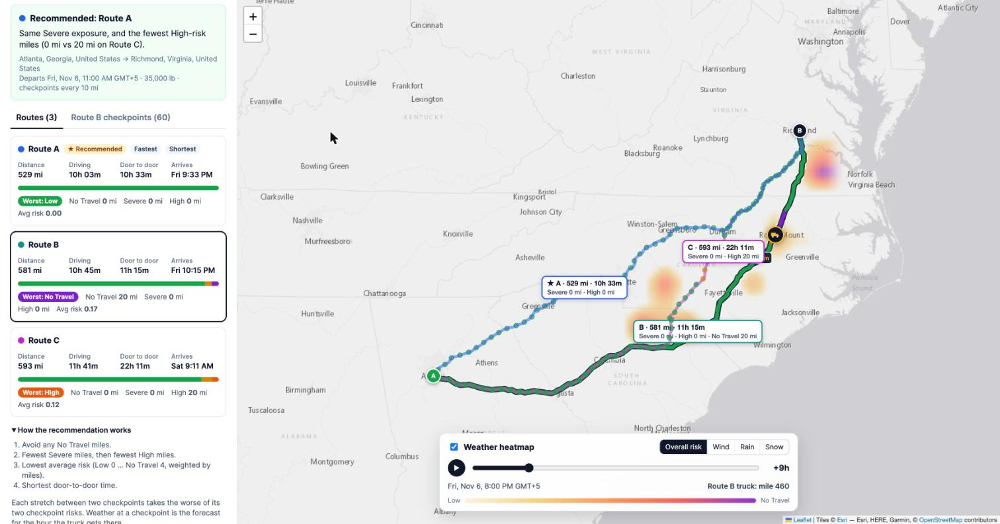

# Weather-Aware Truck Routing

A React + Django app that helps a truck driver pick the safest route between two places. It weighs the forecast weather the truck will actually meet, the load weight and the travel time.

**Live demo:** https://weather-truck-routing-91of.onrender.com (free instance: the first load after idle takes about 50 s) · **Walkthrough (Loom, 5 min):** https://www.loom.com/share/d3c53cfc8d654de9b6d081cfa5595210



_Real forecast, 6 Nov 2026: Route B (selected) hits a No Travel rain band near Rocky Mount at +9 h. Route C has 20 High-risk miles. Route A stays Low and is recommended._


## What it does

1. **Input.** You enter an origin and destination (with autocomplete), a departure date/time and the load weight in pounds. You also pick a checkpoint interval of 10, 25 or 50 miles.
2. **Three route options.** These come from OSRM. OSRM's alternatives often stop at 2, so the app adds a third distinct option by routing through a detour waypoint on either side of the main route.
3. **Checkpoints with real ETAs.** Each route is sampled every 10, 25 or 50 miles. A checkpoint's ETA uses the truck's speed on each road segment (capped at 65 mph) plus optional **Hours-of-Service** rest: a 30-minute break after 8 h of driving and a 10-hour reset after 11 h.
4. **Weather at the ETA.** Each checkpoint uses the Open-Meteo hourly forecast (wind, gusts, rain, snowfall) for the hour the truck reaches that point, not the weather at departure.
5. **Risk and load rules.** Each checkpoint gets a level from Low to No Travel, with the reason (for example "Wind 47 mph (45-54 mph wind with load over 30,000 lb)").
6. **Recommendation.** The app ranks routes by the brief's rules and explains why the winner beat the runner-up.
7. **Map.**
   - The selected route is coloured by risk.
   - Every checkpoint has a popup showing ETA, wind, rain, snow, risk level and reason.
   - Rest stops are marked, and each route has a summary badge.
   - A weather **heatmap** covers the trip corridor, with a **0-48 h slider** and a play button.
   - A truck marker shows where the selected route's truck is at the slider time.

## Risk rules

| Condition | Low | Moderate | High | Severe | No Travel |
|---|---|---|---|---|---|
| Wind | <25 mph | 25-34 | 35-44 | 45-54 | ≥55 |
| Rain | <0.10 in/h | 0.10-0.25 | 0.25-0.50 | 0.50-1.00 | >1.00 |
| Snow | <0.5 in/h | 0.5-1.0 | 1.0-2.0 | 2.0-3.0 | >3.0 |

Load rules:

- Wind ≥55 mph means No Travel for any load.
- 45-54 mph with a load over 30,000 lb means No Travel.
- 35-44 mph with a load over 40,000 lb means Severe.

A checkpoint's level is the worst of wind (after load rules), rain and snow. Where two bands share an edge (rain 0.25), the value goes to the higher band. The top bands are exclusive, as written (">1.00", ">3.0").

**Turning checkpoints into miles.** Each stretch between two consecutive checkpoints takes the worse of its two checkpoint levels and counts its full length at that level. This is deliberately conservative: a stretch is never rated safer than either end.

## Recommendation

Routes are compared in this order (`rank_key` in `backend/routing/planner.py`):

1. Any **No Travel** miles rank below every route without them, because No Travel is worse than Severe.
2. Fewest **Severe** miles.
3. Fewest **High** miles.
4. Lowest **average risk**: Low=0 … No Travel=4, weighted by miles.
5. Shortest **door-to-door time**, including rest.

The UI explains the decision by naming the first rule that separates the winner from the runner-up. If every route has No Travel miles, it advises delaying the departure.

## Architecture

```
frontend/ (React + Vite + react-leaflet)
  App.jsx                     state, data flow
  components/                 TripForm, PlaceInput, RouteCard, CheckpointTable, MapView, HeatControls
  lib/risk.js                 level colours + continuous heat score (mirrors backend thresholds)
  lib/heatFrames.js           pre-renders all 49 heatmap frames; truck position at a time

backend/ (Django, no database)
  routing/planner.py          request validation → routes → checkpoints/ETAs → weather → risk → ranking
  routing/risk.py             thresholds + load rules (pure functions)
  routing/hos.py              driving time → elapsed time with HOS rest stops
  routing/heatmap.py          Mercator-aligned weather grid along the corridor, hours 0-48
  routing/geo.py              haversine, interpolation, RDP simplification, Mercator helpers
  routing/providers/          OSRM, Open-Meteo, Photon/Nominatim, and an offline mock
```

### API

| Endpoint | Description |
|---|---|
| `POST /api/plan` | Body `{origin, destination, departure (ISO, with tz), load_lb, interval_mi: 10\|25\|50, hos: bool}`. Returns routes, checkpoints, rest stops, the recommendation and a `plan_id`. |
| `GET /api/plan/<plan_id>/heatmap` | Corridor grid with wind/rain/snow for 49 hourly steps from departure. |
| `GET /api/geocode?q=` | Place suggestions. |
| `GET /api/health` | Liveness. |

## Performance and smoothness

- **One weather request covers every checkpoint on every route.** Open-Meteo accepts many coordinates per call. Results are cached for 30 minutes per point.
- **The heatmap is a single image overlay, not thousands of map layers.** The backend sends a compact grid (about 200 cells × 49 hours). The browser renders all 49 frames once, with bilinear interpolation of scores (not colours), and the slider only swaps the image. Scrubbing never touches the network.
- The grid is evenly spaced in **Web-Mercator** space, so the stretched image lines up exactly with the map at every zoom.
- Route geometry is simplified (Ramer-Douglas-Peucker, about 60 m) before it is sent. Markers are drawn on canvas.
- The public OSRM and Nominatim servers ask for 1 request/second, which the HTTP layer respects. Retries with backoff handle 429/5xx responses.

## Data sources (free, no API keys)

- Routing: [OSRM](https://project-osrm.org/) public demo server. It uses a car profile; the truck speed cap and HOS model adapt it for trucks.
- Weather: [Open-Meteo](https://open-meteo.com/) hourly forecast, up to 16 days ahead.
- Geocoding: [Photon](https://photon.komoot.io/), with [Nominatim](https://nominatim.org/) as a fallback.
- Basemap: Esri World Light Gray Canvas (Esri, HERE, Garmin, OpenStreetMap contributors).

All base URLs are environment variables (`OSRM_URL`, `OPEN_METEO_URL`, `PHOTON_URL`, `NOMINATIM_URL`), so a self-hosted OSRM with a real truck profile can be swapped in.

## Assumptions and limits

- **Wind:** sustained 10 m wind is used for the rules. Gusts are shown for context but not scored, because the brief's thresholds are for wind speed.
- **Rain/snow:** hourly totals, used as an in/h rate. The weather for a checkpoint is the forecast hour nearest its ETA.
- **HOS:** only the 8-hour break and 11-hour driving limit are modelled. It can be switched off to get plain driving ETAs.
- **Truck routing:** OSRM doesn't know truck restrictions (height, weight, hazmat). A production version would use a truck-aware router such as HERE, PC*MILER or GraphHopper truck.
- **Forecast range:** departure must be within the forecast range. Any part of a trip beyond it is flagged as "Unknown" and excluded from the average.

## Run locally

```bash
# backend (Python 3.11+)
cd backend
pip install -r requirements.txt
python manage.py runserver            # http://127.0.0.1:8000/api/...

# frontend (Node 18+), in another terminal
cd frontend
npm install
npm run dev                           # http://localhost:5173 (proxies /api to Django)
```

Offline demo with synthetic routes and a moving storm, no network needed: `MOCK_PROVIDERS=1 python manage.py runserver`.

Single process (as in production): `cd frontend && npm run build`, then `python manage.py runserver`. Django serves the built app.

## Tests

```bash
cd backend && python manage.py test routing   # risk bands, load rules, HOS, checkpoints, ranking, provider parsing, API
cd frontend && npm test                        # heat score parity with backend, truck position
```

## Deploy (Render, free)

The repo includes a `Dockerfile` and a `render.yaml` blueprint. In Render choose **New → Blueprint**, select this repo, and deploy. The image builds the React app and serves it with Django and gunicorn, with WhiteNoise serving the static files.
